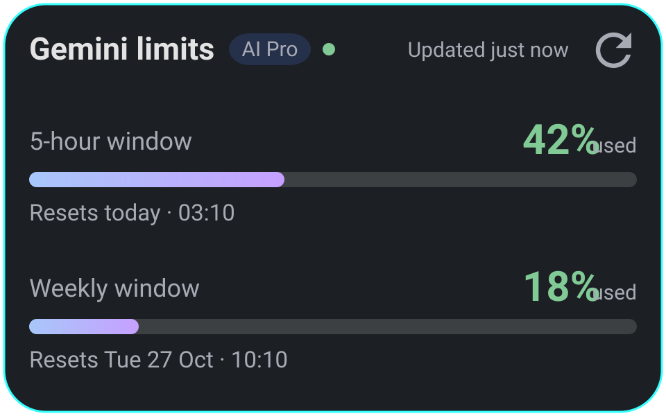

# Gemini Quota

[](https://github.com/rudesssolo/gemini-quota/actions/workflows/build.yml)
[](LICENSE)

An Android home-screen widget that shows your **Gemini subscription usage limits** — the same
compute-based 5-hour and weekly windows that [gemini.google.com/usage](https://gemini.google.com/usage)
shows — with the exact date and time each window resets.

> **Status: personal project, shared as-is.** It was written for one phone and one Google account. The
> endpoints it reads are internal and undocumented, so they can change or vanish without notice, and
> Google can block the cookie-import path at any time. No roadmap, no support promises.

> Unofficial and not affiliated with Google. Google does not publish an API for
> consumer Gemini subscription usage, so the app reads the same internal endpoints the usage page uses.

## What it looks like



*Redrawn from the app's own dark-theme palette (`values-night/colors.xml`). The percentages and reset
times are placeholders, not real usage.*

## What it shows

| Widget state | Content |
|---|---|
| Signed in | 5-hour window and weekly window: % used, full-width progress bar, a reset line that reads "Resets today · 03:10" / "tomorrow" / "Sun 25 Oct · 14:30", plan chip, last-updated stamp |
| Not signed in | "Connect Gemini — tap to sign in" |
| Session expired | "Session expired — tap to sign in" |
| Network/protocol error | Cached numbers stay visible with an "offline" footer, or a retry prompt |

- 5×2 widget, resizable horizontally and vertically (minimum height 160 dp). Surplus height is shared
  evenly between three spacers, so the card always looks filled instead of showing a dead band. Light/dark
  aware.
- Tap the body to open the dashboard; tap the refresh icon to fetch immediately.
- Limits are **compute-based**, so the widget reports percentages and reset times — not a fake
  "prompts remaining" count.

## Why a sign-in is required

- Google has no public API for consumer Gemini subscription usage.
- The Gemini **CLI / Code Assist** quota endpoint is not an option either: Google stopped serving CLI
  OAuth for individual, AI Pro and Ultra accounts on **2026-06-18** (`UNSUPPORTED_CLIENT`,
  `HTTP 403 SUBSCRIPTION_REQUIRED`).
- The only source of truth is the signed-in web session. The app keeps that session encrypted on the
  device and uses two internal endpoints behind `gemini.google.com/usage`:

1. **Primary — GraphQL persisted query** (`UsagePageQuery`): a single GET with the session cookie and
   `Referer: https://gemini.google.com/usage`. Returns
   `data.viewer.rpcs.getUsageInfo.pools` with `GXU_FIVE_HOURLY` / `GXU_WEEKLY`, `percentageUsed` and
   `gxu.windowRefreshesAt`, plus `subscriptionTier`.
2. **Fallback — batchexecute RPC `jSf9Qc`**: scrapes `SNlM0e` / `cfb2h` / `FdrFJe` from the usage page,
   then posts `f.req=[ [ ["jSf9Qc","[]",null,"generic"] ] ]` with `at`. Rows carry
   `usedRatio`, window type (`1` = 5-hour, `2` = weekly) and a reset timestamp.

If Google changes either shape, the widget surfaces a clear "format changed" state instead of showing
wrong numbers, and the dashboard's diagnostics dialog shows the last response snippet.

## Refresh model ("real time", honestly)

Android does not allow continuous background polling without a foreground service, so the app uses a
battery-friendly model:

- **WorkManager periodic refresh every 15 minutes** (platform minimum), network-constrained.
- **Immediate refresh** on widget refresh tap, app open (when older than 5 minutes) and after sign-in.
- **Reset-time refresh**: a one-shot job scheduled for `next reset + 60 s`, so the widget updates right
  when a window rolls over.
- **Absolute reset times, not countdowns**: a `Chronometer` only ticks while its `RemoteViews` is live,
  shows `00:00` if it is never started, and cannot be measured into a fixed-height widget. A wall-clock
  line (`Resets Sun 25 Oct · 14:30`, 24- or 12-hour from the system setting) stays correct after the
  screen was off for hours and costs no ticks. A "Updated 3 min ago" footer makes staleness explicit.

No foreground service, no wake locks, no notification permission, no exact-alarm permission.

## Build

Requirements: JDK 17, Android SDK platform 35 + build-tools 35.0.0, Gradle 8.14.2 (wrapper included).

```bash
./gradlew :app:assembleDebug
# APK: app/build/outputs/apk/debug/app-debug.apk
```

Unit tests (parsers, cookie handling, snapshot codec, HTTP client against MockWebServer):

```bash
./gradlew :app:testDebugUnitTest
```

Lint:

```bash
./gradlew :app:lintDebug
```

`local.properties` points at the SDK (`sdk.dir=/opt/android-sdk` on this machine).

### Building on an aarch64 host

The Android SDK's bundled `aapt2` is an x86-64 binary and cannot run on ARM devices. Point AGP at an
ARM64 build of AAPT2 in your user-level `~/.gradle/gradle.properties` (do not commit this):

```properties
android.aapt2FromMavenOverride=/opt/android-arm64-build-tools/aapt2
```

## Install and use

```bash
adb install -r app/build/outputs/apk/debug/app-debug.apk
```

1. Open **Gemini Quota** and tap **Sign in with Google**. The app opens `gemini.google.com/usage` in a
   WebView with a desktop Chrome user agent.
2. Sign in with the Google account that holds your Gemini plan. If Google refuses embedded browsers
   (see below), use **Import copied cookies** on the same screen instead.
3. The app verifies the session by fetching usage, then stores the cookies encrypted.
4. Long-press your home screen → **Widgets** → **Gemini Quota** → drag the 5×2 widget out.
5. Tap the refresh icon any time you want an immediate update.

### If Google blocks the embedded sign-in

This is the normal case: Google refuses OAuth inside any embedded WebView with *"This browser or app
may not be secure"*, and no user-agent trick changes that. The login screen detects the block and
shows one card with a single action: **Import copied cookies**.

Copy the cookies in any browser where you are already signed in, then open **Gemini Quota**: the login
screen reads the clipboard for you, turns the status green when it finds a Google session, and one tap on
**Connect** finishes the job.

### On the phone, with no computer

This is the whole point of the import path — it needs no second device.

1. Install **Firefox for Android** and open `gemini.google.com`, signed in to the account that holds your
   Gemini plan. (Any real browser can sign in; only embedded WebViews are blocked.)
2. In Firefox: **menu (three dots) → Extensions → Explore more add-ons → Cookie-Editor → Add**.
   Cookie-Editor publishes an official touch-optimised build for Firefox for Android.
3. Still on the `gemini.google.com` tab, open **Cookie-Editor**, tap **Export**, then **Copy**. Both the
   JSON export and the *Header String* export are accepted.
4. Switch back to **Gemini Quota** → **Import copied cookies** → **Connect**.

Any Android browser that loads Chrome extensions works the same way (**Mises**, **Quetta**, **Edge
Canary**). Chrome for Android itself cannot export, and `chrome://net-export` is no help: Chromium
replaces `Cookie` header values with `[N bytes were stripped]` in the log.

### If you do have a computer

1. Open `gemini.google.com` → **F12 → Network** → reload → click the first `gemini.google.com` request →
   right-click the `cookie` request header → **Copy value**.
2. Send that text to the phone (Keep, email, chat) and copy it there.
3. Open the app and tap **Import copied cookies**.

### Why a `document.cookie` copy does not work

The session cookies (`SID`, `__Secure-1PSID`, `SAPISID`) are HttpOnly, so a JavaScript copy would be
unauthenticated — Cookie-Editor reads them through the browser's cookie API instead. The dialog flags a
cookie-less copy in red before you can submit.

## Security and privacy

- The session cookie is a credential. It is encrypted with **AES-256-GCM** using a non-exportable key
  in the **Android Keystore** (`SessionCrypto.kt`) before being written to app-private storage.
- `android:allowBackup="false"` — no cloud backup of the session or usage data.
- Cookies are only sent to `gemini.google.com`; there is no analytics, tracking or third-party SDK.
- The WebView has JavaScript and DOM storage enabled (Gemini needs them) but no JS bridge, no file or
  content access, no password saving, and mixed content blocked.
- Signing out clears the WebView cookies, the encrypted session, the cached snapshot and the widget.
- Diagnostics snippets are shown only inside the app, never logged or uploaded.

## Limitations and risks

- **Unofficial endpoints.** Google can change or block them at any time. Both providers plus a
  diagnostics dialog keep failures explicit, but a future change may require an app update.
- **WebView sign-in is not guaranteed.** Google may reject embedded browsers; the cookie-paste fallback
  exists for that case.
- **No official API.** Account/session handling is inherently more fragile than OAuth.
- **Compute-based limits.** The app deliberately does not display "prompts left".
- **15-minute background floor.** Between refreshes the numbers are last-known; the footer timestamp
  shows how fresh they are.
- **One account at a time.**
- **Consumer plans.** Workspace / Code Assist Standard or Enterprise quotas use different systems.
- Use at your own risk and in line with Google's Terms of Service. Do not publish this app to Google
  Play without reviewing the relevant policies.

## Project layout

```
app/src/main/java/dev/geminiquota/
├── GeminiQuotaApp.kt              Application: repository + widget state collector
├── MainActivity.kt                Dashboard
├── LoginActivity.kt               Google sign-in WebView
├── data/
│   ├── UsageModels.kt             UsageWindow / UsageSnapshot / PlanTier
│   ├── UsageUiState.kt            UI state + refresh/connect outcomes
│   ├── UsageRepository.kt         Serialized refresh, caching, connect/sign-out
│   ├── GeminiUsageClient.kt       GraphQL primary + batchexecute fallback
│   ├── GraphqlUsageParser.kt      UsagePageQuery parser
│   ├── BatchexecuteUsageParser.kt RPC jSf9Qc parser
│   ├── WizTokens.kt               SNlM0e / cfb2h / FdrFJe extraction
│   ├── SessionStore.kt            Encrypted cookie + snapshot + last error
│   ├── SessionCrypto.kt           Android Keystore AES-GCM
│   ├── SnapshotCodec.kt           Cached snapshot JSON
│   ├── CookieUtils.kt             Cookie header normalization/validation
│   └── ErrorKind.kt               Error taxonomy
├── work/
│   ├── RefreshWorker.kt           CoroutineWorker
│   └── RefreshScheduler.kt        Periodic / immediate / reset-time jobs
├── widget/
│   ├── QuotaWidgetProvider.kt     AppWidgetProvider
│   └── QuotaWidgetRenderer.kt     RemoteViews renderer
└── ui/
    ├── UsageFormat.kt             Percent, severity and reset-time helpers
    ├── MainRenderer.kt            Dashboard rendering
    └── CookiePasteDialog.kt       Cookie import fallback
```

Tests live in `app/src/test/java/dev/geminiquota/` — `data/` covers both parsers, token extraction,
cookie normalization, snapshot round-trips and the HTTP client (status mapping, auth detection,
GraphQL → batchexecute fallback) using `MockWebServer`; `ui/` covers the reset-time formatting.

## License

MIT — see [LICENSE](LICENSE). Copyright © 2026 Marco Flavio Gemello.

The license covers this code only. The implementation was informed by publicly documented behaviour of
the Gemini web usage page (CodexBar's gemini-web plugin and the "Gemini Usage Monitor" userscript), and
all trademarks belong to Google. Read the [Limitations and risks](#limitations-and-risks) section before
pointing this at your own account.

